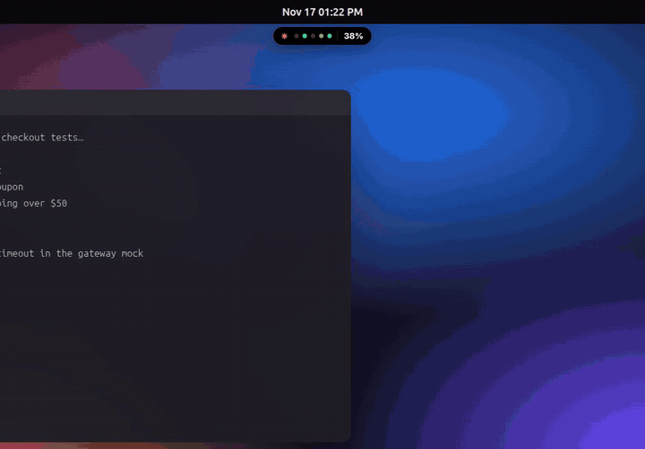
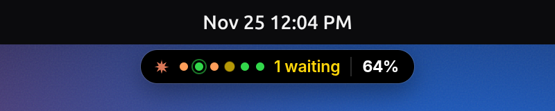
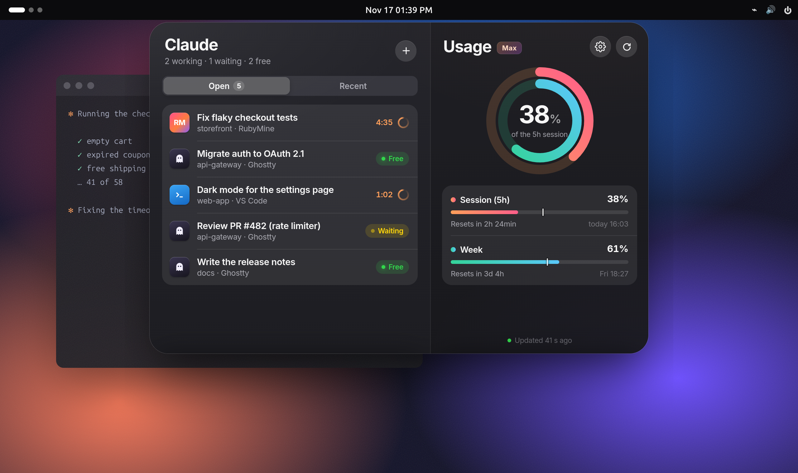
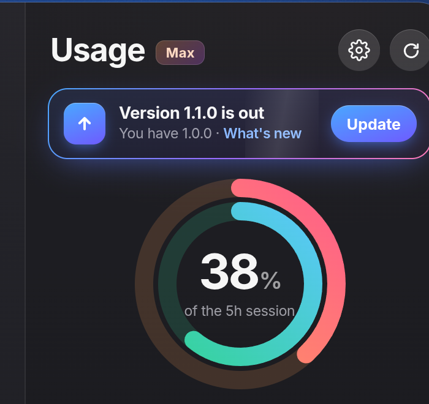

<p align="center">
  
</p>

<h1 align="center">Claude Dock</h1>

<p align="center">
  <strong>Every <a href="https://claude.com/claude-code">Claude Code</a> session you have open, and how much of your plan is left, one hover away.</strong><br>
  A small island under the GNOME top bar that opens into a panel when you point at it.
</p>

<p align="center">
  <strong>English</strong> · <a href="README.pt-BR.md">Português</a>
</p>

<p align="center">
  
  
  
  
  
  
</p>

<p align="center">
  
</p>

## 💡 Why

If you run Claude Code in more than one place, you know the routine. One session is in a terminal tab, two more are inside RubyMine, and another one finished ten minutes ago and has been waiting for you since. Finding the right one means alt-tabbing through everything, and checking how much of your 5-hour window is left means opening yet another thing.

Claude Dock puts all of that in one spot right under the clock. The island shows a dot per running session (🟠 orange while it works, 🟢 green when it's free, 🟡 yellow when it's waiting on you) next to your current usage. Point at it and the panel opens. Click a session and its window comes to the front.

<p align="center">
  
</p>

## What's in the panel

<p align="center">
  
</p>

On the left is every Claude Code session running right now, with the app it lives in: Ghostty, RubyMine and the other JetBrains IDEs, VS Code or a regular terminal. Working sessions show a live timer of how long they've been at it. Click one and Claude Dock raises that exact window.

On the right is your plan usage. The 5-hour session (when your account has one) and the weekly limit show up as rings and bars, each with a countdown to its reset. The small tick on a bar marks how much of that window has already gone by, so you can see at a glance if you're spending faster than the clock.

### Pick up where you left off

<p align="center">
  
</p>

The Recent tab lists past sessions grouped by day, with their real titles. Type to filter by title or project and the matching text lights up. Clicking one opens a terminal in that folder running `claude --resume` for that session.

### Start a new one

<p align="center">
  
</p>

The + button lists the folders you've used recently. Pick one, or browse to any other, and a terminal opens there with `claude` already running.

### Show only what you care about

<p align="center">
  
</p>

The gear opens the settings. You can hide the usage on the island, turn off update alerts and turn each part of the usage panel on or off: plan badge, rings, 5h session, week, time marker and reset times. Two extras start hidden and can be switched on there: weekly limits per model, and a breakdown of where your usage went (Claude Code, chats, Cowork). The language follows your system, and you can change it in the same place.

## Features

| | |
|---|---|
| Live sessions | Reads what Claude Code already writes to `~/.claude`. There is nothing to configure and no hook to install |
| Jump to the window | Matches each session to its window by process tree and title, then raises it with `wmctrl` |
| Resume from history | Opens a terminal in the right folder with `claude --resume <id>` |
| New session | Recent folders, or any folder through the file picker |
| Plan usage | 5-hour and weekly limits, reset countdown, per-model limits and where it went |
| Search | Filters past sessions by title or project and highlights the match |
| Stays out of the way | Clicks pass through everywhere except the island and the open panel. Keyboard focus goes back to your previous window when the panel closes |
| Light | Python standard library plus the GTK and WebKit your desktop already ships. Usage is fetched every 2 minutes, or right away when you hit refresh |
| Updates itself | Shows when a new release is out and installs it with one click |
| Two languages | English and Portuguese, following the system language |

## 📦 Install

```bash
curl -fsSL https://raw.githubusercontent.com/krugerrgabriel/claude-dock/main/install.sh | sh
```

That line downloads the latest release into `~/.local/share/claude-dock` and installs the three system packages it needs if any is missing (apt will ask for your password). Then it adds an app menu entry, sets the dock to start when you log in and starts it. Run the same line again to update.

You need Linux on an X11 session and Claude Code logged in on that machine. It was built and tested on Ubuntu 24.04 with GNOME 46. The packages are `python3-gi`, `gir1.2-webkit2-4.1` and `wmctrl`, and most Ubuntu desktops already have the first two.

<details>
<summary>Install from source</summary>

```bash
sudo apt install python3-gi gir1.2-webkit2-4.1 wmctrl
git clone https://github.com/krugerrgabriel/claude-dock.git
cd claude-dock
python3 install.py
```

`install.py` creates the `claude-dock` command in `~/.local/bin`, the app menu entry and the autostart entry, then starts the dock. Pass `--no-start` if you'd rather start it yourself.

To try it without installing anything, run `./claude-dock` from the cloned folder.
</details>

<details>
<summary>Uninstall</summary>

```bash
python3 ~/.local/share/claude-dock/install.py --uninstall
```

This stops the dock and removes the command, the menu entry and the autostart entry. Your settings stay in `~/.config/claude-dock` in case you come back.
</details>

## 🔄 Updates

Claude Dock checks GitHub for a new release when it starts and every 6 hours after that. When there is one, a blue arrow shows up on the island, and the usage column opens with a card at the top. Click Update and the dock downloads the release, swaps its files and reopens by itself. If you'd rather not be told, turn off "Update alerts" in the settings.

<p align="center">
  <br>
  
</p>

## Using it

| Action | What happens |
|---|---|
| Point at the island | The panel opens after a short pause, so passing by on the way to the clock doesn't trigger it |
| Move the mouse away | The panel closes |
| Click an open session | Its window comes to the front |
| Click a recent session | A terminal opens in that folder and resumes it |
| + | New session in a recent folder or any folder you pick |
| Gear | Settings |
| Refresh arrow | Fetches your usage right now |

## Settings file

Everything in the settings sheet is saved to `~/.config/claude-dock/config.json`. One key only exists in the file:

```json
{
  "terminal": "ghostty"
}
```

`terminal` picks the terminal for new and resumed sessions: `ghostty`, `kitty`, `wezterm`, `alacritty`, `ptyxis`, `gnome-terminal` or `konsole`. Without it, Claude Dock uses the first one it finds in that order. Restart the dock after editing the file by hand.

## How it works

```
~/.claude/sessions/<pid>.json        sessions running now (Claude Code keeps these up to date)
~/.claude/projects/*/<id>.jsonl      transcripts: title, folder, branch, first message
~/.claude/.credentials.json          the token Claude Code already uses, for the usage request
            │
            ▼
claude_dock/   sessions.py   live sessions and history, read straight from disk
               windows.py    finds and raises the right window (wmctrl)
               launch.py     opens a terminal running claude or claude --resume
               usage.py      plan usage from api.anthropic.com
               app.py        transparent GTK window under the top bar, with a WebKit view
               ui/           the island and the panel (HTML, CSS, JS)
```

The window is transparent and has a fixed size. The page tells the Python side which rectangle is clickable at any moment (the island when closed, the panel when open), and the X11 input shape lets every other click through to whatever is underneath.

## 🔒 Privacy

Session data stays on your machine. Claude Dock makes two network requests. One is the usage check, `GET https://api.anthropic.com/api/oauth/usage`, sent with the token Claude Code already stores in `~/.claude/.credentials.json`. The other asks GitHub for the latest release (`api.github.com/repos/krugerrgabriel/claude-dock/releases/latest`) and sends nothing about you. From your transcripts, Claude Dock reads the session title, the folder, the git branch and the first message (used as a label when a session has no title yet). It never writes anything inside `~/.claude`.

## Troubleshooting

<details>
<summary>The island doesn't show up</summary>

Check your session type with `echo $XDG_SESSION_TYPE`. Claude Dock needs `x11`. On Wayland, GNOME doesn't let a window place itself or bring other windows forward. Pick "Ubuntu on Xorg" on the login screen.
</details>

<details>
<summary>Clicking a session doesn't bring its window forward</summary>

Make sure `wmctrl` is installed (`sudo apt install wmctrl`). With a tabbed terminal the dock raises the window, and it can only tell which tab holds the session when that tab is the active one. For the terminal inside a JetBrains IDE, it raises the project window.
</details>

<details>
<summary>The usage panel shows an error</summary>

"Credentials are stale" or "Token expired" means the token in `~/.claude/.credentials.json` is old. Open Claude Code in a terminal once and it renews it. "Too many requests" clears up by itself, since the dock waits longer between tries. If you run another usage widget too, both are calling the same endpoint.
</details>

<details>
<summary>Debugging</summary>

`CLAUDE_DOCK_DEBUG=1 claude-dock` logs every message between the page and Python and enables the WebKit inspector (right click, Inspect). To work on the interface in a normal browser, serve the repository with `python3 -m http.server` and open `tools/stage.html?lang=en`. It runs the panel with sample data over a fake desktop, and it's how the screenshots in this README were made.
</details>

## License

MIT. Do whatever you want with it.

If you like having Claude Code on screen, take a look at [Claude Pet](https://github.com/krugerrgabriel/claude-pet), a pixel robot that walks around your screen showing what Claude is doing, and [Claude Sessions Manager](https://github.com/krugerrgabriel/claude-sessions-manager), a local dashboard for finding and resuming any past conversation.
