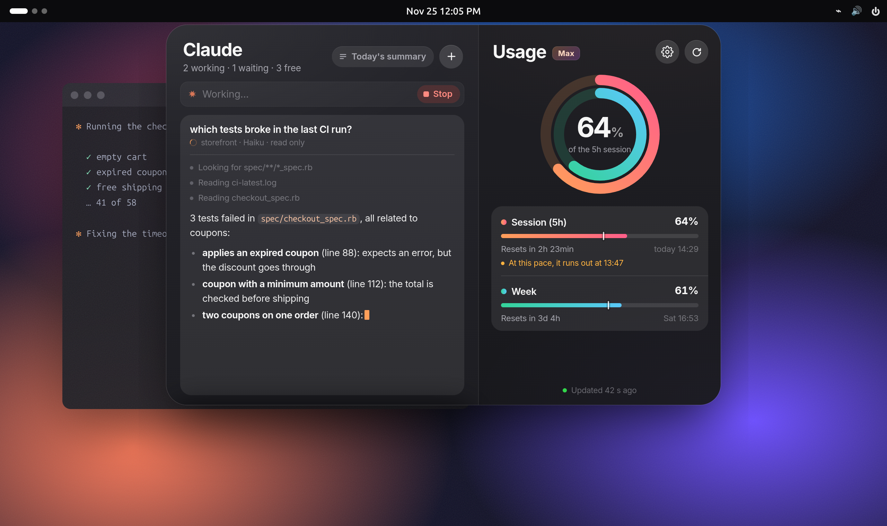
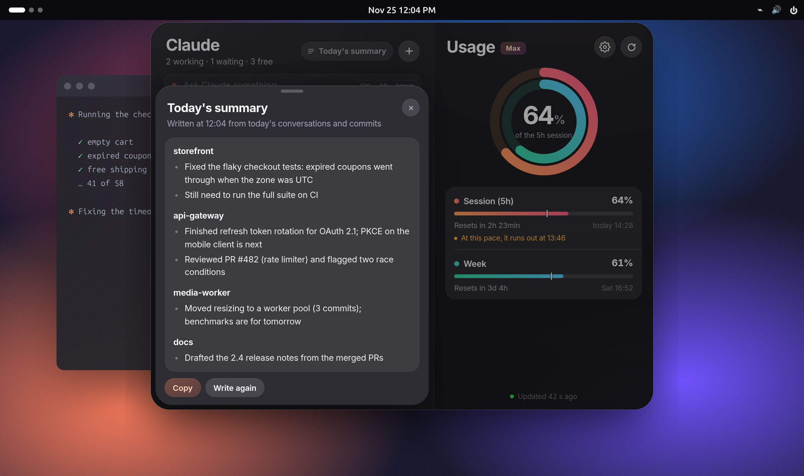
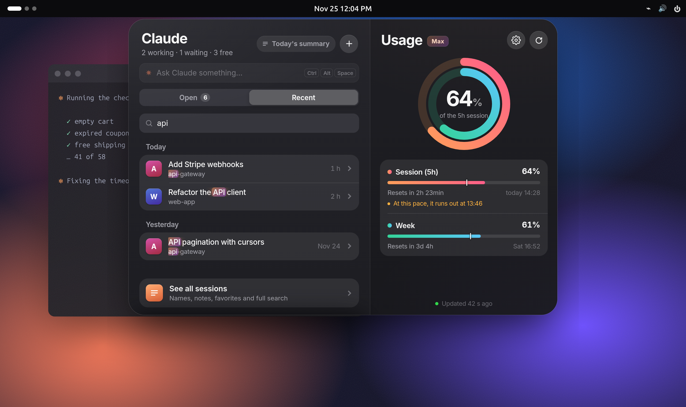
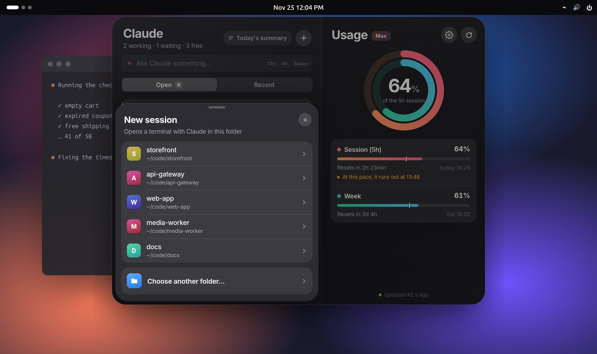
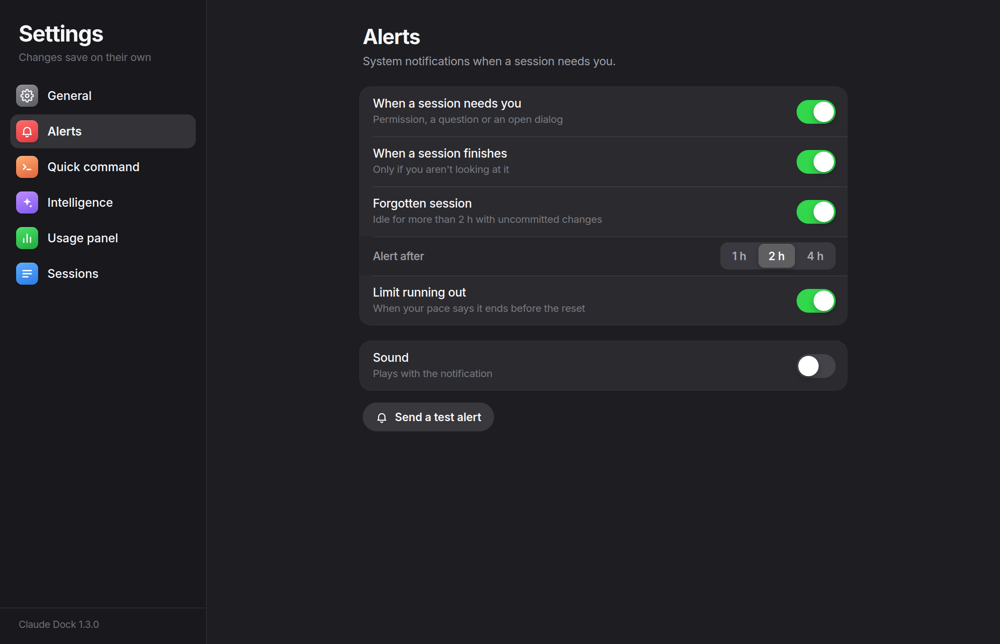
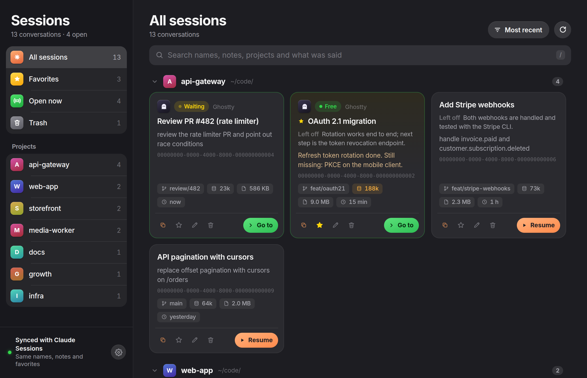
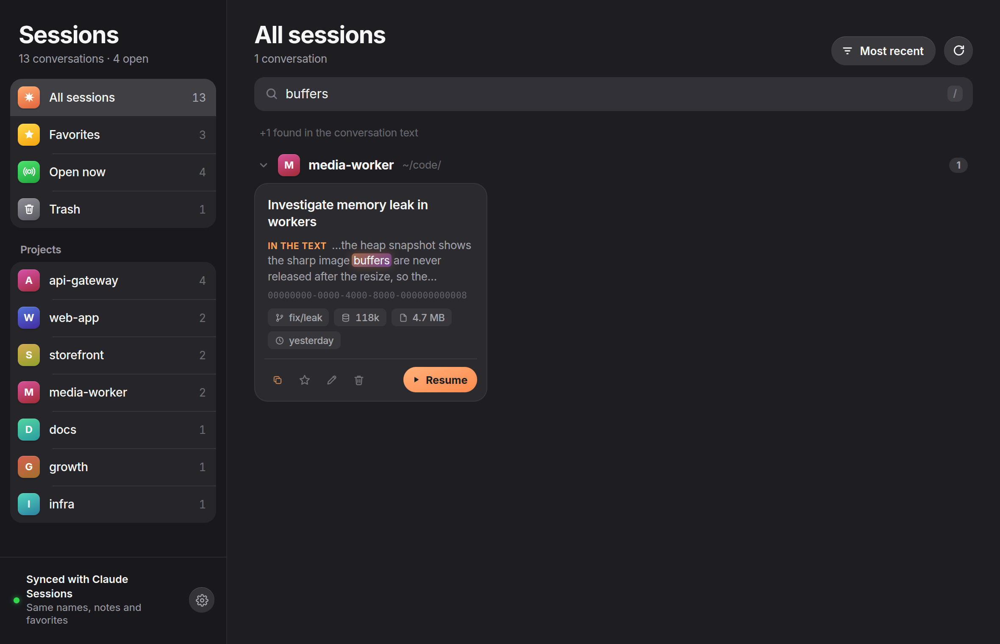
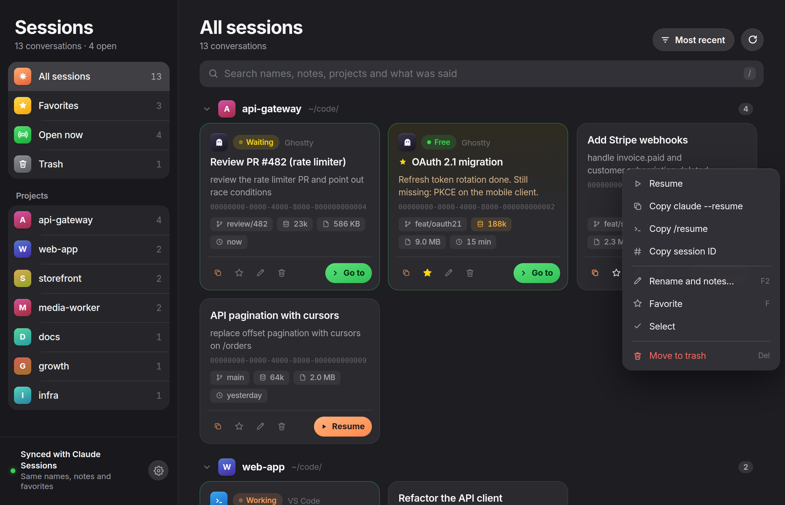
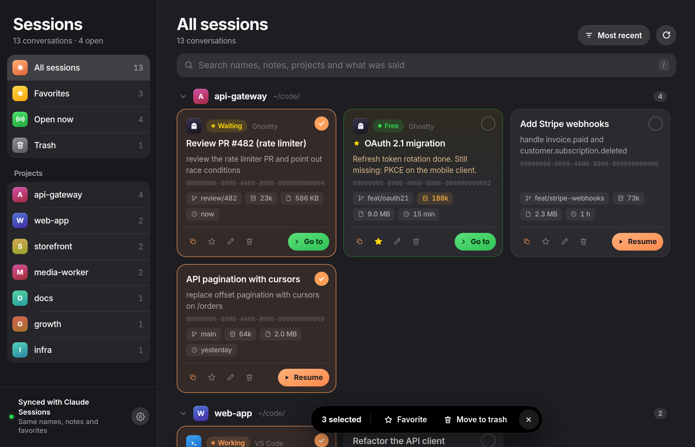

<p align="center">
  
</p>

<h1 align="center">Claude Dock</h1>

<p align="center">
  <strong>Every <a href="https://claude.com/claude-code">Claude Code</a> session you have open, your whole conversation history and how much of your plan is left, one hover away.</strong><br>
  A small island under the GNOME top bar that opens into a panel when you point at it.
</p>

<p align="center">
  <strong>English</strong> · <a href="README.pt-BR.md">Português</a>
</p>

<p align="center">
  
  
  
  
  
  
</p>

<p align="center">
  
</p>

## 💡 Why

If you run Claude Code in more than one place, you know the routine. One session is in a terminal tab, two more are inside RubyMine, and another one finished ten minutes ago and has been waiting for you since. Finding the right one means alt-tabbing through everything, and checking how much of your 5-hour window is left means opening yet another thing.

Claude Dock puts all of that in one spot right under the clock. The island shows a dot per running session (🟠 orange while it works, 🟢 green when it's free, 🟡 yellow when it's waiting on you) next to your current usage. When a session is waiting, the island also says so in words, like "1 waiting", until you answer it. Point at it and the panel opens. Click a session and its window comes to the front.

<p align="center">
  
</p>

## What's in the panel

<p align="center">
  
</p>

On the left is every Claude Code session running right now, with the app it lives in: Ghostty, RubyMine and the other JetBrains IDEs, VS Code or a regular terminal. Working sessions show a live timer of how long they've been at it. Click one and Claude Dock raises that exact window.

Sessions waiting on you go to the top, with a yellow edge and the reason (asking for permission, a question for you, an open dialog). One that finished while you were looking elsewhere says "finished 3 min ago" until you go to it. The line under each title also tells you where it left off, and a session that has been idle for hours with uncommitted files says so in orange, so nothing gets forgotten at the end of the day.

On the right is your plan usage. The 5-hour session (when your account has one) and the weekly limit show up as rings and bars, each with a countdown to its reset. The small tick on a bar marks how much of that window has already gone by, so you can see at a glance if you're spending faster than the clock. If your pace over the last 30 minutes would hit the limit before it resets, a line under the bar tells you when: "At this pace, it runs out at 13:44".

### Know when a session needs you

You don't have to keep the panel open to find out. Claude Dock sends a system notification when a session stops to ask you something and when one finishes a long job (only if you aren't already looking at its window). Several at once turn into a single notification, and "Go to session" takes you straight there. It can also tell you about a forgotten session and when your 5-hour limit is about to run out. Each alert can be turned off, and sound is off unless you want it.

### Ask from anywhere

<p align="center">
  
</p>

Press **Ctrl+Alt+Space** from any app and the panel opens with the cursor in the request field. Type a question, hit Enter and the answer streams in right there, with a discreet line for each file it reads. It runs in the folder of your most recent session (the chip next to the field lets you pick another one), and by default it can only read and search, never change your project. When the answer is ready, just type again to follow up: the next request continues the same conversation, so Claude remembers what you asked before. You can also copy the answer, start a new conversation or continue it in a terminal. If you close the panel while it works, the request keeps going and a notification tells you when it's done. The arrow keys bring back your last requests.

The shortcut can be changed or turned off in the settings, along with what the quick command is allowed to do (read only, edit files, or everything) and which model it uses.

### Where you left off

Every open session shows the start of Claude's last message under its title, and so do the cards in the sessions window. That alone is usually enough to remember what was going on. If you want something sharper, switch "Where I left off" to "With AI" and Haiku writes one sentence per session saying what was done and what's left. That mode is off by default.

### Today's summary

<p align="center">
  
</p>

The "Today's summary" button gathers today's conversations and your commits from today and writes a short standup update, grouped by project. Copy it and paste it wherever your team keeps track. It only runs when you click the button, and if you close the panel while it writes, a notification lets you know when it's ready.

### Runs on your plan

The quick command, the AI recap and today's summary run `claude -p` with the Claude Code you already have logged in, so they count toward your Claude plan's usage like any other request. There's no API key to set up and nothing is billed separately. The quick command and the summary only run when you ask, and the AI recap only runs if you turn it on.

### Pick up where you left off

<p align="center">
  
</p>

The Recent tab lists past sessions grouped by day, with their real titles. Type to filter by title or project and the matching text lights up. Clicking one opens a terminal in that folder running `claude --resume` for that session, or copies the command if you set it up that way in the settings.

### Start a new one

<p align="center">
  
</p>

The + button lists the folders you've used recently. Pick one, or browse to any other, and a terminal opens there with `claude` already running.

### Settings in one place

<p align="center">
  
</p>

The gear, in the panel or in the sessions window, opens a single settings window. Every change saves on its own. It's split into sections:

- **General**: language (it follows your system unless you pick one), what clicking a session does (open the terminal, copy `claude --resume` or copy `/resume`), which terminal to use, usage on the island and update alerts.
- **Alerts**: which notifications you get, after how many hours a session counts as forgotten, sound, and a button to send a test alert.
- **Quick command**: the shortcut (click Change and press the new keys, or turn it off), what it can do, the default folder and the model.
- **Intelligence**: where I left off (simple, with AI or off) and the "Today's summary" button.
- **Usage panel**: each part of the usage column with a live preview: plan badge, rings, 5h session, week, time marker and reset times. Two extras start hidden: weekly limits per model, and where your usage went (Claude Code, chats, Cowork).
- **Sessions**: the automatic trash and where names and notes are kept.

## 🗂️ Your whole history, organized

Every project has a hidden cost: **warming the context back up**. Each time you start Claude from scratch, time goes into explaining the architecture again, saying where you stopped, pointing at the files that matter. When the terminal closes, the context it just built goes with it.

Claude Code already saves every conversation so you can resume it. The hard part is finding the right one among dozens of IDs that tell you nothing. That's why Claude Dock comes with a window holding every conversation you've ever had.

> **Resuming takes seconds. Starting over takes hours.**

<p align="center">
  
</p>

It opens from "See all sessions", pinned to the bottom of the panel. Conversations show up as cards grouped by project, each with its title, where it left off, the first message or your note, the branch, how full the context was and when it was last active. Sessions running right now get a status badge, and clicking one takes you to its window instead of opening a second copy.

### Find it by the word you remember

<p align="center">
  
</p>

Search filters by name, note, project and branch as you type. A moment later it also looks inside what was actually said and shows the passage it found. That session where you talked about the heap snapshot is one word away.

### Your way: open or copy

<p align="center">
  
</p>

You pick what a click does: open a terminal with the conversation resumed, copy `cd folder && claude --resume id` to paste into any terminal, or copy `/resume id` to paste into a Claude that's already running. The choice applies to the panel and the window. Right click keeps all three at hand, along with rename, favorite and trash.

### Tidy up several at once

<p align="center">
  
</p>

Tick a card's circle, hold Shift to grab a range, and a bar shows up at the bottom to favorite them or send them all to the trash. Every action has Undo in case you change your mind. The trash only hides: the conversation files stay in `~/.claude` and come back whenever you want. In the settings you can also turn on the automatic trash for sessions untouched for 30, 60 or 90 days (favorites never go).

| | |
|---|---|
| 🔁 **One click resume** | Opens the terminal in the right folder, or copies the command, whichever you prefer |
| 📋 **Copy format** | `claude --resume` for the terminal or `/resume` for inside Claude |
| 🏷️ **Names and notes** | A human name for each conversation and a note on where you stopped |
| 📍 **Where you left off** | The end of Claude's last message on every card, or one sentence written by AI if you turn it on |
| ⭐ **Favorites** | The conversations you use every day, always at hand |
| 🔍 **Full text search** | Finds sessions by what was said in them, with the passage highlighted |
| 🟢 **Open now** | Running sessions are marked and clicking goes to their window |
| 🌡️ **Context at a glance** | Conversations close to a full context show in yellow and red |
| ↕️ **Sorting** | Most recent, oldest, largest context, largest file or name |
| ☑️ **Bulk selection** | Favorite or trash several at once, with Undo |
| 🗑️ **Safe trash** | Only hides, nothing is deleted from disk. Optional automatic trash |
| ⌨️ **Keyboard** | `/` searches, arrows move through the cards, Enter does what a click does, `c` copies, `e` edits, `f` stars |

If you use [Claude Sessions Manager](https://github.com/krugerrgabriel/claude-sessions-manager), the window reads and writes the same file it does, and the cards follow the same layout. Names, notes, favorites and the trash stay the same in both, so you can use one, the other or both. Without it, the dock keeps its own copy in the same format.

## Features

| | |
|---|---|
| Live sessions | Reads what Claude Code already writes to `~/.claude`. There is nothing to configure and no hook to install |
| Jump to the window | Matches each session to its window by process tree and title, then raises it with `wmctrl` |
| Resume from history | Opens a terminal in the right folder with `claude --resume <id>`, or copies `claude --resume` or `/resume` |
| Alerts | System notifications when a session needs you or finishes, grouped, with a button that takes you to it |
| Quick command | Ctrl+Alt+Space from anywhere, the answer streams in the panel. Read only by default, the shortcut can be changed |
| Where I left off | The last thing Claude said in each session, or a one sentence AI recap (off by default) |
| Forgotten session | Warns about sessions idle for hours with uncommitted files, at most once a day per session |
| Limit forecast | Tells you when the 5-hour limit runs out at your current pace, and warns 30 minutes before |
| Today's summary | A standup update written from today's conversations and commits, ready to copy |
| New session | Recent folders, or any folder through the file picker |
| Plan usage | 5-hour and weekly limits, reset countdown, per-model limits, where it went and a forecast at your pace |
| Search | Filters past sessions by title or project and highlights the match |
| All sessions | A window with your whole history as cards: names, notes, favorites, trash, bulk selection, sorting and search inside the conversations |
| Stays out of the way | Clicks pass through everywhere except the island and the open panel. Keyboard focus goes back to your previous window when the panel closes |
| Light | Python standard library plus the GTK and WebKit your desktop already ships. Usage is fetched every 2 minutes, or right away when you hit refresh |
| Your own plan | The AI features run on the Claude Code you already use. No API key, nothing billed separately |
| Updates itself | Shows when a new release is out and installs it with one click |
| Two languages | English and Portuguese, following the system language |

## 📦 Install

```bash
curl -fsSL https://raw.githubusercontent.com/krugerrgabriel/claude-dock/main/install.sh | sh
```

That line downloads the latest release into `~/.local/share/claude-dock` and installs the three system packages it needs if any is missing (apt will ask for your password). Then it adds an app menu entry, sets the dock to start when you log in and starts it. Run the same line again to update.

You need Linux on an X11 session and Claude Code logged in on that machine. It was built and tested on Ubuntu 24.04 with GNOME 46. The packages are `python3-gi`, `gir1.2-webkit2-4.1` and `wmctrl`, and most Ubuntu desktops already have the first two.

<details>
<summary>Install from source</summary>

```bash
sudo apt install python3-gi gir1.2-webkit2-4.1 wmctrl
git clone https://github.com/krugerrgabriel/claude-dock.git
cd claude-dock
python3 install.py
```

`install.py` creates the `claude-dock` command in `~/.local/bin`, the app menu entry and the autostart entry, then starts the dock. Pass `--no-start` if you'd rather start it yourself.

To try it without installing anything, run `./claude-dock` from the cloned folder.
</details>

<details>
<summary>Uninstall</summary>

```bash
python3 ~/.local/share/claude-dock/install.py --uninstall
```

This stops the dock and removes the command, the menu entry and the autostart entry. Your settings stay in `~/.config/claude-dock` in case you come back.
</details>

## 🔄 Updates

Claude Dock checks GitHub for a new release when it starts and every 6 hours after that. When there is one, a blue arrow shows up on the island, and the usage column opens with a card at the top. Click Update and the dock downloads the release, swaps its files and reopens by itself. If you'd rather not be told, turn off "New version alerts" in the settings.

<p align="center">
  <br>
  
</p>

## Using it

| Action | What happens |
|---|---|
| Ctrl+Alt+Space | Opens the panel with the cursor in the quick command field, from any app. You can change it or turn it off in the settings |
| Point at the island | The panel opens after a short pause, so passing by on the way to the clock doesn't trigger it |
| Move the mouse away | The panel closes |
| Click an open session | Its window comes to the front |
| Click a recent session | A terminal opens in that folder and resumes it. In the settings you can switch this to copying `claude --resume` or `/resume`, and the sessions window follows the same choice |
| + | New session in a recent folder or any folder you pick |
| Enter in the request field | Sends the request. Up and down bring back your last ones, Esc clears or closes |
| Today's summary | Writes the summary of your day, with Copy and Write again |
| Gear | Opens the settings window |
| Refresh arrow | Fetches your usage right now |
| See all sessions | Opens the sessions window, or brings it to the front if it's already open |
| `/` in the sessions window | Jumps to search. Arrow keys move between cards, Enter does the same as a click, `e` edits, `f` stars, Delete sends to the trash, `c` copies the resume command |
| Right click on a session | Menu with resume, copy `claude --resume`, `/resume` or the ID, rename, favorite, select and trash |

## Settings file

Everything in the settings window is saved to `~/.config/claude-dock/config.json`. You rarely need to touch it, but this is what the main keys look like:

```json
{
  "terminal": "ghostty",
  "notify": { "waiting": true, "done": true, "forgotten": true, "forgottenHours": 2, "limit": true, "sound": false },
  "ask": { "shortcut": "<Control><Alt>space", "mode": "read", "cwd": "auto", "model": "auto" },
  "recap": { "mode": "simple" },
  "summary": { "enabled": true }
}
```

`terminal` picks the terminal for new and resumed sessions: `ghostty`, `kitty`, `wezterm`, `alacritty`, `ptyxis`, `gnome-terminal` or `konsole`. Without it, Claude Dock uses the first one it finds in that order. `ask.shortcut` uses the GNOME format, and `"off"` turns it off. Restart the dock after editing the file by hand.

The shortcut is registered as a GNOME custom keyboard shortcut called "Claude Dock: comando rápido", which runs `claude-dock --ask`. Your other custom shortcuts are left alone.

Claude Dock finds Claude Sessions Manager through the Apache config. If you installed it somewhere unusual, set `sessionsManagerDir` to its install folder (the one with `app.wsgi` and `data/`).

## How it works

```
~/.claude/sessions/<pid>.json        sessions running now (Claude Code keeps these up to date)
~/.claude/projects/*/<id>.jsonl      transcripts: title, folder, branch, first message
~/.claude/.credentials.json          the token Claude Code already uses, for the usage request
            │
            ▼
claude_dock/   sessions.py   live sessions and history, read straight from disk
               windows.py    finds and raises the right window (wmctrl)
               launch.py     opens a terminal running claude or claude --resume
               usage.py      plan usage from api.anthropic.com
               library.py    every conversation, names and notes, search inside transcripts
               alerts.py     notices when a session waits or finishes, and shows the notifications
               ask.py        the quick command: runs claude -p and streams the answer
               insights.py   AI recap, forgotten sessions, limit forecast and today's summary
               cli.py        how the dock calls claude -p (no hooks, no session of its own)
               hotkey.py     the GNOME shortcut for the quick command
               app.py        transparent GTK window under the top bar, with a WebKit view
               ui/           the island, the panel and the settings window (HTML, CSS, JS)
```

The window is transparent and has a fixed size. The page tells the Python side which rectangle is clickable at any moment (the island when closed, the panel when open), and the X11 input shape lets every other click through to whatever is underneath.

## 🔒 Privacy

Session data stays on your machine unless you use one of the AI features. Claude Dock itself makes two network requests. One is the usage check, `GET https://api.anthropic.com/api/oauth/usage`, sent with the token Claude Code already stores in `~/.claude/.credentials.json`. The other asks GitHub for the latest release (`api.github.com/repos/krugerrgabriel/claude-dock/releases/latest`) and sends nothing about you. From your transcripts, Claude Dock reads the session title, the folder, the git branch and the first message (used as a label when a session has no title yet). The sessions window also reads the transcripts in full when you search inside them, on your machine. Claude Dock never writes anything inside `~/.claude`: names, notes, favorites and the trash go to Claude Sessions Manager's `data/metadata.json` when it's installed, or to `~/.local/share/claude-dock/metadata.json` when it isn't. The trash only hides a session. Its file stays where it was. To open fast, the dock keeps what it read from each transcript (title, folder, branch, first message, the start of Claude's last message, size) in `~/.cache/claude-dock/transcripts.json`. You can delete that file anytime.

The AI features go through your own `claude` command, the same way a request typed in a terminal would, and nothing else. The quick command sends what you type and lets Claude read the folder it runs in. The AI recap, only when you turn it on, sends the last few thousand characters of a conversation. Today's summary, only when you click it, sends the titles, your requests and where each session left off from today, plus the subject lines of your commits from today. To find forgotten sessions and today's commits, the dock runs `git status` and `git log` in your project folders, locally. Recaps, usage samples for the forecast and the quick command history live in `~/.cache/claude-dock/` and `~/.local/state/claude-dock/`.

## Troubleshooting

<details>
<summary>The island doesn't show up</summary>

Check your session type with `echo $XDG_SESSION_TYPE`. Claude Dock needs `x11`. On Wayland, GNOME doesn't let a window place itself or bring other windows forward. Pick "Ubuntu on Xorg" on the login screen.
</details>

<details>
<summary>Clicking a session doesn't bring its window forward</summary>

Make sure `wmctrl` is installed (`sudo apt install wmctrl`). With a tabbed terminal the dock raises the window, and it can only tell which tab holds the session when that tab is the active one. For the terminal inside a JetBrains IDE, it raises the project window.
</details>

<details>
<summary>The usage panel shows an error</summary>

"Credentials are stale" or "Token expired" means the token in `~/.claude/.credentials.json` is old. Open Claude Code in a terminal once and it renews it. "Too many requests" clears up by itself, since the dock waits longer between tries. If you run another usage widget too, both are calling the same endpoint.
</details>

<details>
<summary>The shortcut doesn't open the panel</summary>

The shortcut is a GNOME custom keyboard shortcut. Check that it shows up in Settings, Keyboard, Custom Shortcuts, and that no other shortcut uses the same keys (pick another one in the dock's settings if it does). On other desktops, create a shortcut by hand that runs `claude-dock --ask`.
</details>

<details>
<summary>Alerts don't show up</summary>

Click "Send a test alert" in the Alerts section. If nothing appears, check that GNOME isn't in Do Not Disturb mode and that notifications are on for Claude Dock. Waiting sessions still show on the island and in the panel either way.
</details>

<details>
<summary>Debugging</summary>

`CLAUDE_DOCK_DEBUG=1 claude-dock` logs every message between the page and Python and enables the WebKit inspector (right click, Inspect). To work on the interface in a normal browser, serve the repository with `python3 -m http.server` and open `tools/stage.html?lang=en`. It runs the panel with sample data over a fake desktop, and it's how the screenshots in this README were made.
</details>

## License

MIT. Do whatever you want with it.

If you like having Claude Code on screen, take a look at [Claude Pet](https://github.com/krugerrgabriel/claude-pet), a pixel robot that walks around your screen showing what Claude is doing, and [Claude Sessions Manager](https://github.com/krugerrgabriel/claude-sessions-manager), a local dashboard for finding and resuming any past conversation.
