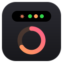
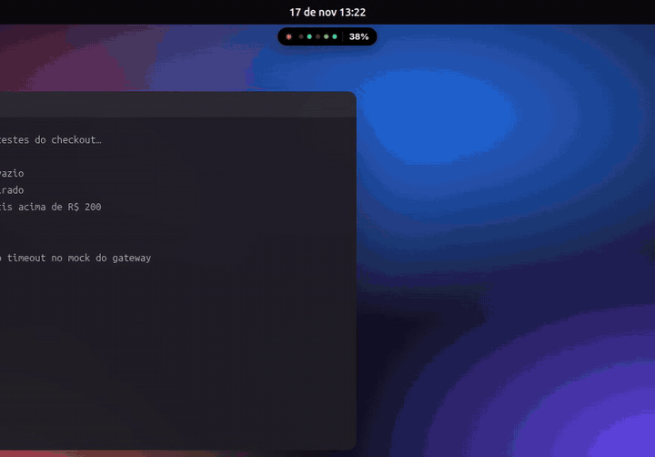
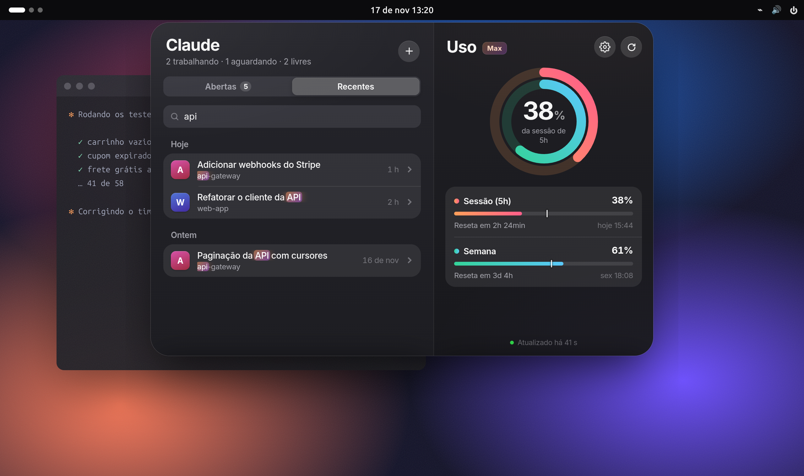
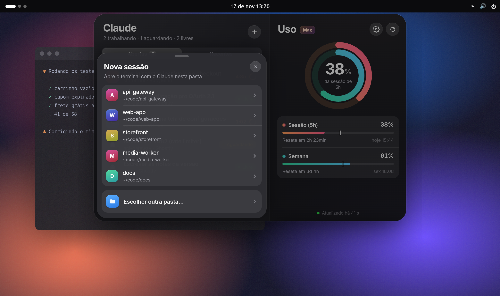

<p align="center">
  
</p>

<h1 align="center">Claude Dock</h1>

<p align="center">
  <strong>Todas as sessões do <a href="https://claude.com/claude-code">Claude Code</a> que você tem abertas, e quanto ainda resta do seu plano, a um passar de mouse.</strong><br>
  Uma ilhinha embaixo do top bar do GNOME que vira um painel quando você aponta pra ela.
</p>

<p align="center">
  <a href="README.md">English</a> · <strong>Português</strong>
</p>

<p align="center">
  
  
  
  
  
  
</p>

<p align="center">
  
</p>

## Pra que serve

Quem roda o Claude Code em mais de um lugar conhece a rotina. Uma sessão está numa aba do terminal, outras duas estão dentro do RubyMine, e mais uma terminou faz dez minutos e está te esperando desde então. Achar a certa é ficar dando alt-tab em tudo, e ver quanto sobrou da janela de 5 horas é abrir mais uma coisa.

O Claude Dock junta tudo isso num lugar só, logo abaixo do relógio. A ilha mostra uma bolinha por sessão rodando (laranja enquanto trabalha, verde quando está livre, amarela quando está esperando você) ao lado do seu consumo atual. Aponte pra ela e o painel abre. Clique numa sessão e a janela dela vem pra frente.

<p align="center">
  
</p>

## O que tem no painel

<p align="center">
  
</p>

À esquerda ficam todas as sessões do Claude Code rodando agora, com o app onde cada uma está: Ghostty, RubyMine e as outras IDEs da JetBrains, VS Code ou um terminal comum. As que estão trabalhando mostram um cronômetro de quanto tempo estão nisso. Clicou, o Claude Dock traz aquela janela exata pra frente.

À direita fica o uso do seu plano. A sessão de 5 horas (quando a sua conta tem) e o limite semanal aparecem em anéis e barras, cada um com a contagem até resetar. O tracinho na barra marca quanto daquela janela já passou, então dá pra ver de relance se você está gastando mais rápido que o relógio.

### Volte de onde parou

<p align="center">
  
</p>

A aba Recentes lista as sessões anteriores agrupadas por dia, com o título de verdade de cada uma. Digite pra filtrar por título ou projeto e o trecho encontrado acende. Clicar numa delas abre um terminal naquela pasta rodando `claude --resume` daquela sessão.

### Comece uma nova

<p align="center">
  
</p>

O botão + lista as pastas que você usou por último. Escolha uma, ou procure qualquer outra, e um terminal abre lá com o `claude` já rodando.

### Mostre só o que importa pra você

<p align="center">
  
</p>

A engrenagem abre as configurações. Dá pra esconder o uso da ilha e ligar ou desligar cada parte do painel de uso: selo do plano, anéis, sessão de 5h, semana, marcador de tempo e quando reseta. Dois extras começam desligados e podem ser ativados ali: os limites semanais por modelo e a divisão de onde o consumo foi gasto (Claude Code, chats, Cowork). O idioma segue o do sistema, e também dá pra trocar ali.

## Recursos

| | |
|---|---|
| Sessões ao vivo | Lê o que o Claude Code já grava em `~/.claude`. Não tem nada pra configurar nem hook pra instalar |
| Vai até a janela | Liga cada sessão à sua janela pela árvore de processos e pelo título, e traz ela pra frente com o `wmctrl` |
| Retoma do histórico | Abre um terminal na pasta certa com `claude --resume <id>` |
| Nova sessão | Pastas recentes, ou qualquer pasta pelo seletor de arquivos |
| Uso do plano | Limites de 5 horas e semanal, contagem até o reset, limites por modelo e onde foi gasto |
| Busca | Filtra as sessões anteriores por título ou projeto e realça o trecho encontrado |
| Não atrapalha | O clique passa direto em tudo, menos na ilha e no painel aberto. O foco do teclado volta pra janela em que você estava quando o painel fecha |
| Leve | Biblioteca padrão do Python mais o GTK e o WebKit que o seu desktop já tem. O uso é consultado a cada 2 minutos, ou na hora quando você clica em atualizar |
| Dois idiomas | Inglês e português, seguindo o idioma do sistema |

## Instalação

```bash
curl -fsSL https://raw.githubusercontent.com/krugerrgabriel/claude-dock/main/install.sh | sh
```

Essa linha baixa a última versão em `~/.local/share/claude-dock` e instala os três pacotes do sistema que ele precisa, caso falte algum (o apt vai pedir sua senha). Depois cria um atalho no menu de apps, configura o dock pra abrir junto com o login e já inicia ele. Pra atualizar, rode a mesma linha de novo.

Você precisa de Linux numa sessão X11 e do Claude Code logado na máquina. Ele foi feito e testado no Ubuntu 24.04 com GNOME 46. Os pacotes são `python3-gi`, `gir1.2-webkit2-4.1` e `wmctrl`, e a maioria dos desktops Ubuntu já vem com os dois primeiros.

<details>
<summary>Instalar a partir do código</summary>

```bash
sudo apt install python3-gi gir1.2-webkit2-4.1 wmctrl
git clone https://github.com/krugerrgabriel/claude-dock.git
cd claude-dock
python3 install.py
```

O `install.py` cria o comando `claude-dock` em `~/.local/bin`, o atalho no menu de apps e a entrada de inicialização automática, e depois inicia o dock. Use `--no-start` se preferir iniciar você mesmo.

Pra testar sem instalar nada, rode `./claude-dock` dentro da pasta clonada.
</details>

<details>
<summary>Desinstalar</summary>

```bash
python3 ~/.local/share/claude-dock/install.py --uninstall
```

Fecha o dock e remove o comando, o atalho do menu e a inicialização automática. Suas configurações ficam em `~/.config/claude-dock`, caso você volte.
</details>

## Como usar

| Ação | O que acontece |
|---|---|
| Apontar pra ilha | O painel abre depois de uma pausa curta, pra não abrir quando você só passa a caminho do relógio |
| Tirar o mouse | O painel fecha |
| Clicar numa sessão aberta | A janela dela vem pra frente |
| Clicar numa sessão recente | Abre um terminal naquela pasta retomando a sessão |
| + | Nova sessão numa pasta recente ou em qualquer pasta que você escolher |
| Engrenagem | Configurações |
| Seta de atualizar | Consulta o uso na hora |

## Arquivo de configuração

Tudo o que você muda nas configurações fica salvo em `~/.config/claude-dock/config.json`. Só uma chave existe apenas no arquivo:

```json
{
  "terminal": "ghostty"
}
```

`terminal` escolhe o terminal das sessões novas e retomadas: `ghostty`, `kitty`, `wezterm`, `alacritty`, `ptyxis`, `gnome-terminal` ou `konsole`. Sem ela, o Claude Dock usa o primeiro que encontrar nessa ordem. Reinicie o dock depois de editar o arquivo na mão.

## Como funciona

```
~/.claude/sessions/<pid>.json        sessões rodando agora (o Claude Code mantém atualizado)
~/.claude/projects/*/<id>.jsonl      transcripts: título, pasta, branch, primeira mensagem
~/.claude/.credentials.json          o token que o Claude Code já usa, pra consulta de uso
            │
            ▼
claude_dock/   sessions.py   sessões ao vivo e histórico, lidos direto do disco
               windows.py    acha e traz pra frente a janela certa (wmctrl)
               launch.py     abre um terminal rodando claude ou claude --resume
               usage.py      uso do plano em api.anthropic.com
               app.py        janela GTK transparente embaixo do top bar, com um WebKit dentro
               ui/           a ilha e o painel (HTML, CSS, JS)
```

A janela é transparente e tem tamanho fixo. A página avisa o Python qual retângulo pode receber clique a cada momento (a ilha quando fechado, o painel quando aberto), e o input shape do X11 deixa todos os outros cliques passarem pro que estiver embaixo.

## Privacidade

Os dados das sessões não saem da sua máquina. A única requisição de rede é a consulta de uso, `GET https://api.anthropic.com/api/oauth/usage`, feita com o token que o Claude Code já guarda em `~/.claude/.credentials.json`. Dos seus transcripts, o Claude Dock lê o título da sessão, a pasta, a branch do git e a primeira mensagem (usada como nome quando a sessão ainda não tem título). Ele nunca escreve nada dentro de `~/.claude`.

## Problemas comuns

<details>
<summary>A ilha não aparece</summary>

Veja o tipo da sua sessão com `echo $XDG_SESSION_TYPE`. O Claude Dock precisa de `x11`. No Wayland, o GNOME não deixa uma janela se posicionar sozinha nem trazer outras janelas pra frente. Escolha "Ubuntu on Xorg" na tela de login.
</details>

<details>
<summary>Clicar numa sessão não traz a janela pra frente</summary>

Confira se o `wmctrl` está instalado (`sudo apt install wmctrl`). Num terminal com abas, o dock traz a janela, e só consegue saber qual aba tem a sessão quando ela é a aba ativa. No terminal de dentro de uma IDE da JetBrains, ele traz a janela do projeto.
</details>

<details>
<summary>O painel de uso mostra um erro</summary>

"Credencial vencida" ou "Token expirou" quer dizer que o token em `~/.claude/.credentials.json` está velho. Abra o Claude Code num terminal uma vez e ele renova. "Muitas consultas" se resolve sozinho, porque o dock espera mais entre uma tentativa e outra. Se você usa outro widget de consumo junto, os dois estão chamando o mesmo endereço.
</details>

<details>
<summary>Depuração</summary>

`CLAUDE_DOCK_DEBUG=1 claude-dock` mostra no terminal cada mensagem entre a página e o Python e liga o inspetor do WebKit (botão direito, Inspecionar). Pra mexer na interface num navegador comum, sirva o repositório com `python3 -m http.server` e abra `tools/stage.html?lang=pt`. Ele roda o painel com dados de exemplo sobre um desktop falso, e foi assim que os prints deste README foram feitos.
</details>

## Licença

MIT. Faça o que quiser com ele.

Se você gosta de ter o Claude Code à vista, dá uma olhada no [Claude Pet](https://github.com/krugerrgabriel/claude-pet), um robozinho em pixel art que anda pela tela mostrando o que o Claude está fazendo, e no [Claude Sessions Manager](https://github.com/krugerrgabriel/claude-sessions-manager), um painel local pra achar e retomar qualquer conversa antiga.
