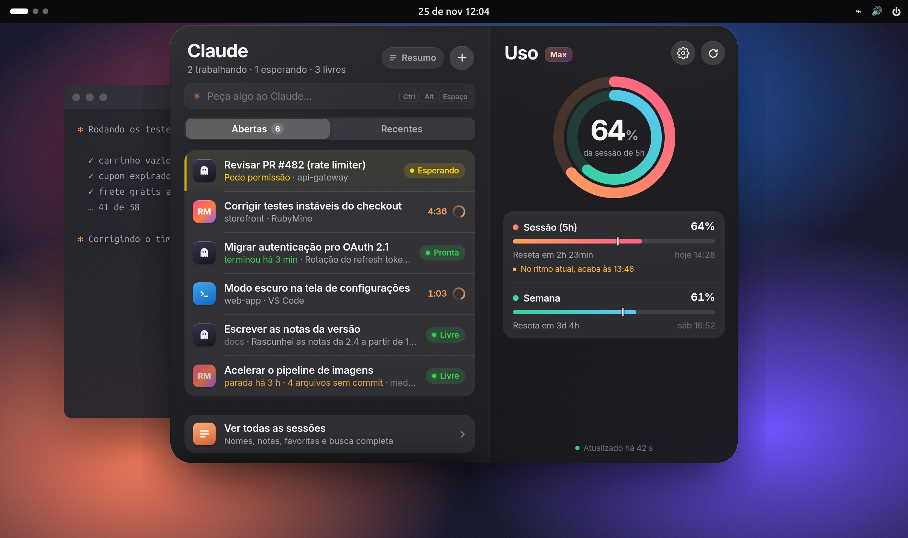
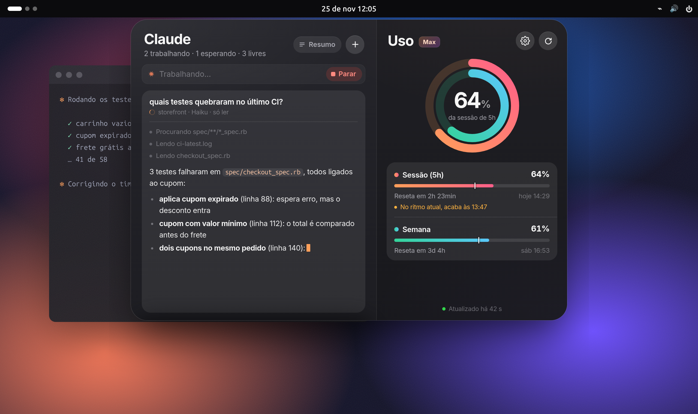
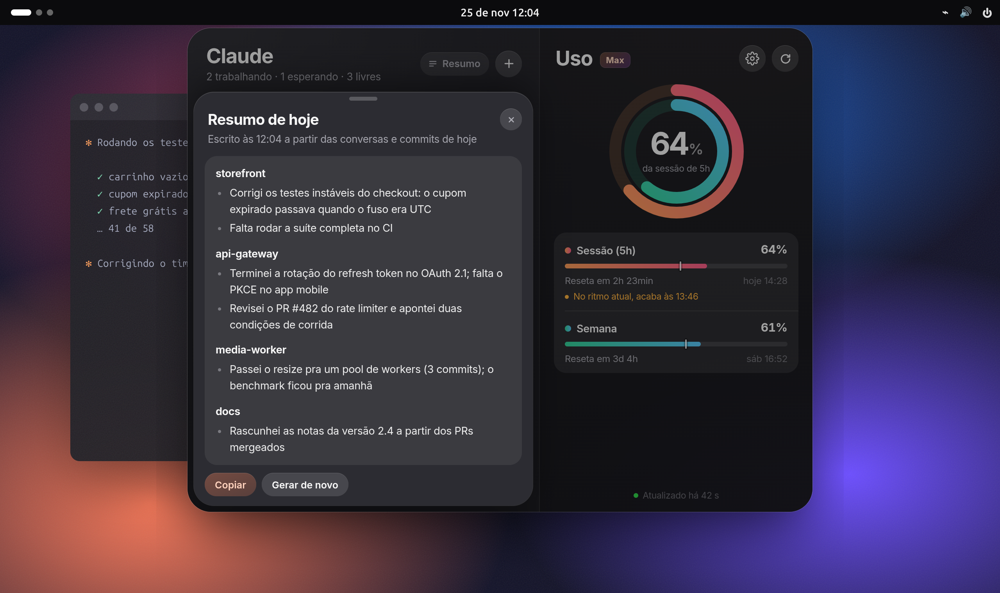
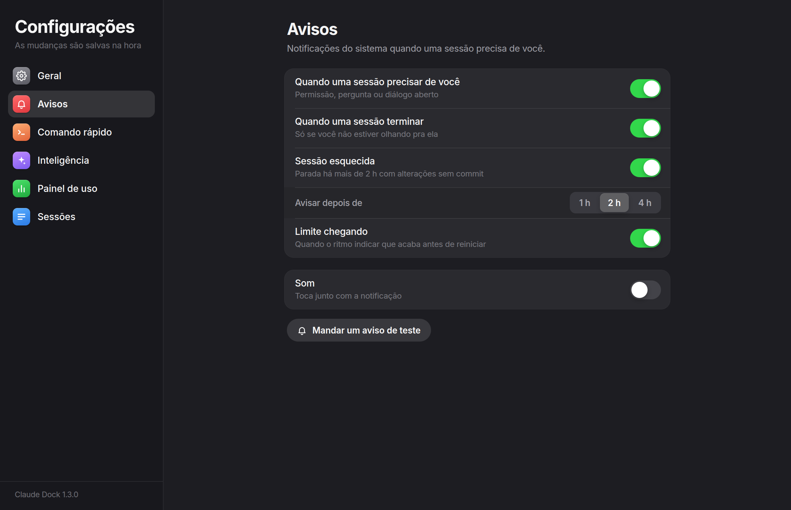
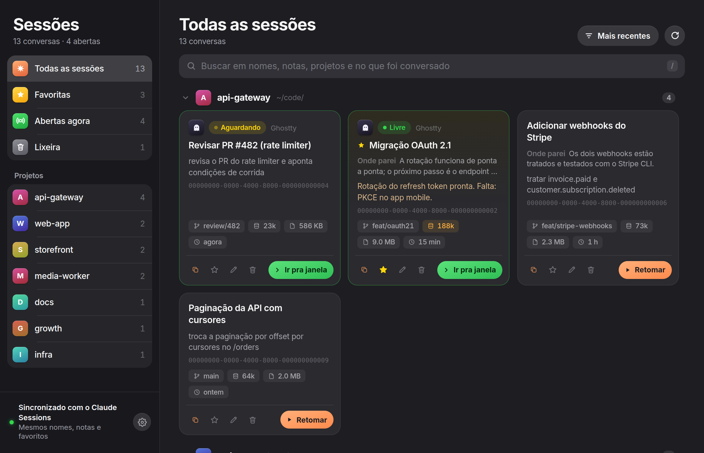
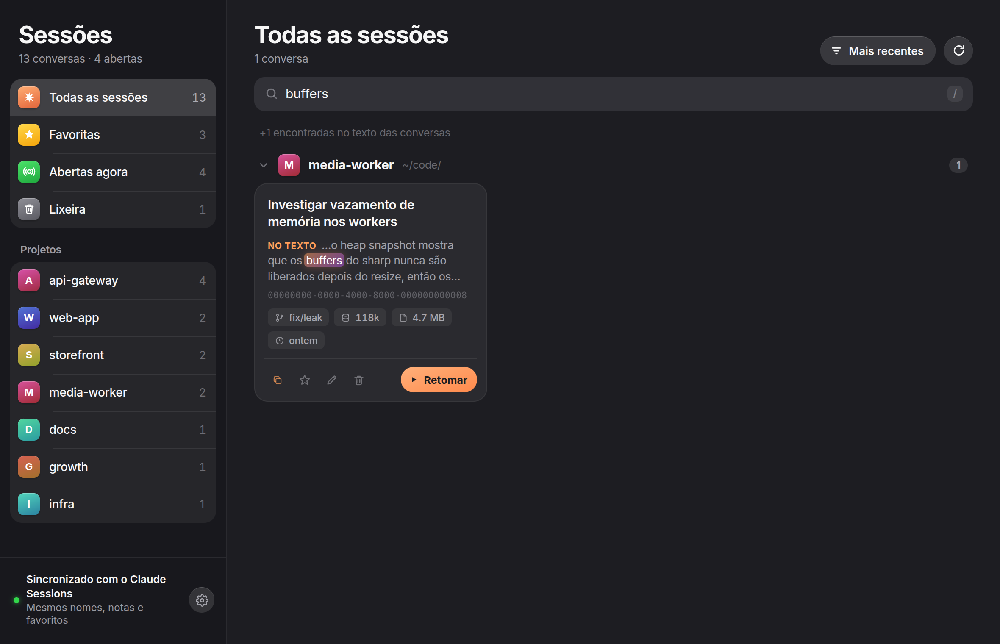
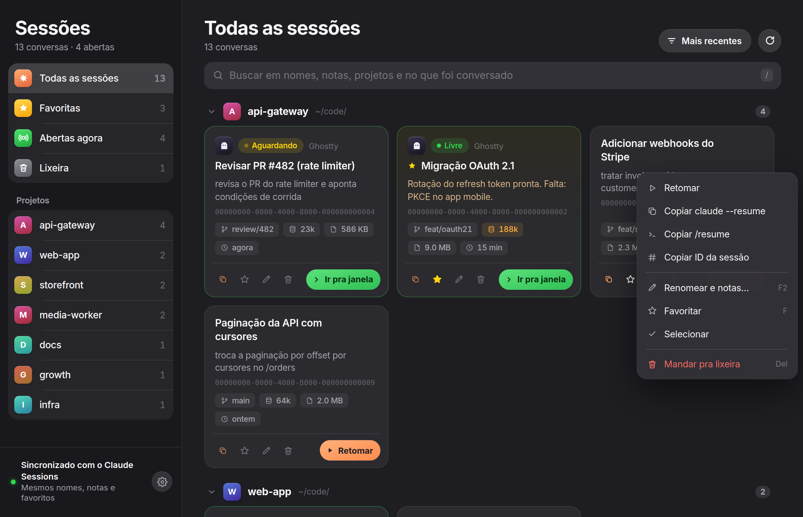
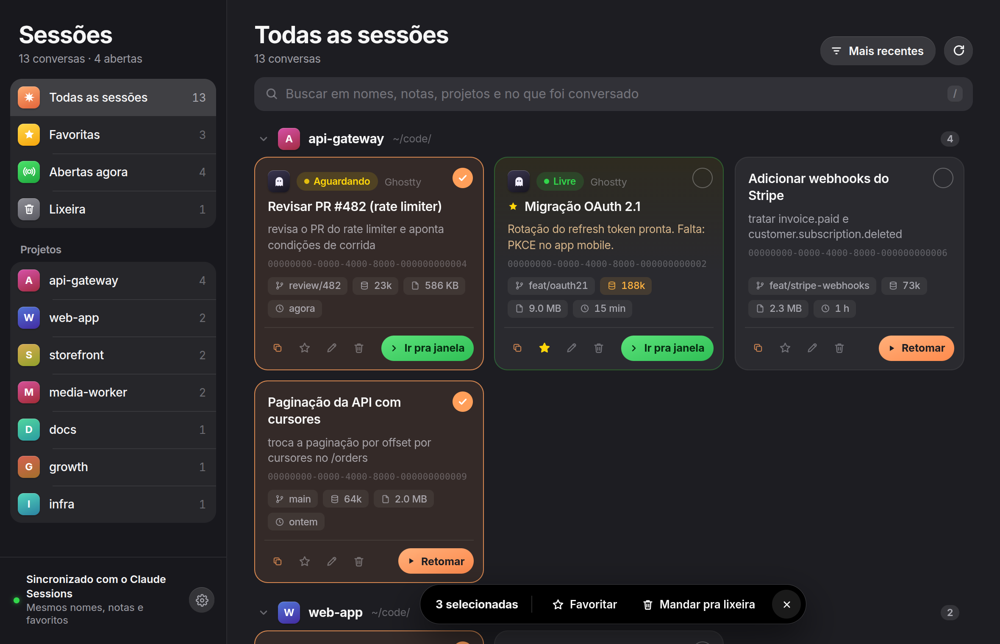
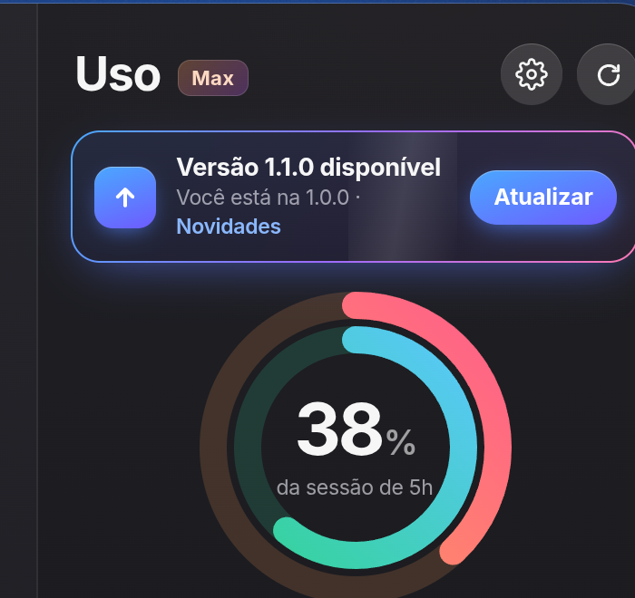

<p align="center">
  
</p>

<h1 align="center">Claude Dock</h1>

<p align="center">
  <strong>Todas as sessões do <a href="https://claude.com/claude-code">Claude Code</a> que você tem abertas, o histórico inteiro das suas conversas e quanto ainda resta do seu plano, a um passar de mouse.</strong><br>
  Uma ilhinha embaixo do top bar do GNOME que vira um painel quando você aponta pra ela.
</p>

<p align="center">
  <a href="README.md">English</a> · <strong>Português</strong>
</p>

<p align="center">
  
  
  
  
  
  
</p>

<p align="center">
  
</p>

## 💡 Pra que serve

Quem roda o Claude Code em mais de um lugar conhece a rotina. Uma sessão está numa aba do terminal, outras duas estão dentro do RubyMine, e mais uma terminou faz dez minutos e está te esperando desde então. Achar a certa é ficar dando alt-tab em tudo, e ver quanto sobrou da janela de 5 horas é abrir mais uma coisa.

O Claude Dock junta tudo isso num lugar só, logo abaixo do relógio. A ilha mostra uma bolinha por sessão rodando (🟠 laranja enquanto trabalha, 🟢 verde quando está livre, 🟡 amarela quando está esperando você) ao lado do seu consumo atual. Quando alguma sessão está esperando, a ilha também escreve, tipo "1 esperando", até você responder. Aponte pra ela e o painel abre. Clique numa sessão e a janela dela vem pra frente.

<p align="center">
  
</p>

## O que tem no painel

<p align="center">
  
</p>

À esquerda ficam todas as sessões do Claude Code rodando agora, com o app onde cada uma está: Ghostty, RubyMine e as outras IDEs da JetBrains, VS Code ou um terminal comum. As que estão trabalhando mostram um cronômetro de quanto tempo estão nisso. Clicou, o Claude Dock traz aquela janela exata pra frente.

As sessões que estão esperando você sobem pro topo, com uma borda amarela e o motivo (pede permissão, tem uma pergunta pra você, abriu um diálogo). A que terminou enquanto você olhava pra outro lado mostra "terminou há 3 min" até você ir até ela. A linha embaixo de cada título também conta onde ela parou, e uma sessão parada há horas com arquivos sem commit avisa em laranja, pra nada ficar esquecido no fim do dia.

À direita fica o uso do seu plano. A sessão de 5 horas (quando a sua conta tem) e o limite semanal aparecem em anéis e barras, cada um com a contagem até resetar. O tracinho na barra marca quanto daquela janela já passou, então dá pra ver de relance se você está gastando mais rápido que o relógio. Se no ritmo dos últimos 30 minutos o limite for acabar antes de resetar, uma linha embaixo da barra mostra a hora: "No ritmo atual, acaba às 13:44".

### Saiba quando uma sessão precisa de você

Não precisa ficar com o painel aberto pra descobrir. O Claude Dock manda uma notificação do sistema quando uma sessão para pra te perguntar algo e quando uma termina um trabalho longo (só se você não estiver olhando pra janela dela). Várias ao mesmo tempo viram uma notificação só, e "Ir pra sessão" te leva direto pra lá. Ele também avisa de sessão esquecida e quando o limite de 5 horas está pra acabar. Cada aviso pode ser desligado, e o som só toca se você quiser.

### Peça de qualquer lugar

<p align="center">
  
</p>

Aperte **Ctrl+Alt+Espaço** em qualquer app e o painel abre com o cursor no campo de pedido. Escreva a pergunta, dê Enter e a resposta vai aparecendo ali mesmo, com uma linha discreta pra cada arquivo que ele lê. Ele roda na pasta da sua sessão mais recente (o chip ao lado do campo deixa escolher outra) e, por padrão, só lê e procura, nunca mexe no seu projeto. Com a resposta pronta, é só escrever de novo pra continuar: o próximo pedido segue na mesma conversa, e o Claude lembra do que você perguntou antes. Também dá pra copiar a resposta, começar uma conversa nova ou continuar num terminal. Se você fechar o painel no meio, o pedido continua e uma notificação avisa quando acabar. As setas trazem de volta os seus últimos pedidos.

Nas configurações dá pra trocar ou desligar o atalho, escolher o que o comando rápido pode fazer (só ler, editar arquivos ou tudo) e qual modelo ele usa.

### Onde parei

Cada sessão aberta mostra o começo da última fala do Claude embaixo do título, e os cards da janela de sessões também. Só isso costuma bastar pra lembrar do que se tratava. Se quiser algo mais certeiro, mude "Onde parei" pra "Com IA" e o Haiku escreve uma frase por sessão dizendo o que foi feito e o que falta. Esse modo vem desligado.

### Resumo de hoje

<p align="center">
  
</p>

O botão "Resumo" junta as conversas de hoje e os seus commits do dia e escreve um resumo curto pra daily, separado por projeto. É só copiar e colar onde o seu time acompanha. Ele só roda quando você clica e, se você fechar o painel enquanto ele escreve, uma notificação avisa quando ficar pronto.

### Roda no seu plano

O comando rápido, o "onde parei" com IA e o resumo de hoje rodam o `claude -p` com o Claude Code que você já tem logado, então contam no uso do seu plano do Claude como qualquer outro pedido. Não tem chave de API pra configurar nem cobrança à parte. O comando rápido e o resumo só rodam quando você pede, e o "onde parei" com IA só roda se você ligar.

### Volte de onde parou

<p align="center">
  
</p>

A aba Recentes lista as sessões anteriores agrupadas por dia, com o título de verdade de cada uma. Digite pra filtrar por título ou projeto e o trecho encontrado acende. Clicar numa delas abre um terminal naquela pasta rodando `claude --resume` daquela sessão, ou copia o comando, se você preferir assim nas configurações.

### Comece uma nova

<p align="center">
  
</p>

O botão + lista as pastas que você usou por último. Escolha uma, ou procure qualquer outra, e um terminal abre lá com o `claude` já rodando.

### Configurações num lugar só

<p align="center">
  
</p>

A engrenagem, no painel ou na janela de sessões, abre uma janela de configurações só. Cada mudança é salva na hora. Ela é dividida em seções:

- **Geral**: idioma (segue o do sistema, a não ser que você escolha), o que o clique numa sessão faz (abrir o terminal, copiar `claude --resume` ou copiar `/resume`), qual terminal usar, uso na ilha e aviso de versão nova.
- **Avisos**: quais notificações você recebe, depois de quantas horas uma sessão conta como esquecida, som e um botão pra mandar um aviso de teste.
- **Comando rápido**: o atalho (clique em Trocar e aperte as teclas novas, ou desative), o que ele pode fazer, a pasta padrão e o modelo.
- **Inteligência**: onde parei (simples, com IA ou desligado) e o botão "Resumo".
- **Painel de uso**: cada parte da coluna de uso com uma prévia ao vivo: selo do plano, anéis, sessão de 5h, semana, marcador de tempo e quando reseta. Dois extras começam desligados: os limites semanais por modelo e onde o consumo foi gasto (Claude Code, chats, Cowork).
- **Sessões**: a lixeira automática e onde ficam os nomes e as notas.

## 🗂️ Seu histórico inteiro, organizado

Todo projeto tem um custo escondido: **reaquecer o contexto**. Cada vez que você abre um Claude do zero, vai tempo explicando de novo a arquitetura, dizendo onde parou, apontando os arquivos que importam. Quando o terminal fecha, o contexto que ele acabou de montar vai junto.

O Claude Code já guarda cada conversa pra você retomar. O difícil é achar a certa no meio de dezenas de IDs que não dizem nada. Por isso o Claude Dock traz uma janela com todas as conversas que você já teve.

> **Retomar custa segundos. Recomeçar custa horas.**

<p align="center">
  
</p>

Ela abre por "Ver todas as sessões", que fica fixo no pé do painel. As conversas aparecem em cards agrupados por projeto, cada um com o título, onde a conversa parou, a primeira mensagem ou a sua anotação, a branch, quanto do contexto estava ocupado e quando foi a última atividade. As sessões rodando agora ganham o selo de status, e clicar numa delas leva até a janela dela em vez de abrir uma segunda cópia.

### Ache pela palavra que você lembra

<p align="center">
  
</p>

A busca filtra por nome, nota, projeto e branch enquanto você digita. Um instante depois ela também procura dentro do que foi conversado e mostra o trecho que achou. Aquela sessão em que vocês falaram do heap snapshot fica a uma palavra de distância.

### Do seu jeito: abrir ou copiar

<p align="center">
  
</p>

Você escolhe o que o clique faz: abrir um terminal com a conversa retomada, copiar `cd pasta && claude --resume id` pra colar em qualquer terminal, ou copiar `/resume id` pra colar num Claude que já está aberto. A escolha vale pro painel e pra janela. O botão direito tem as três opções sempre à mão, junto com renomear, favoritar e mandar pra lixeira.

### Arrume várias de uma vez

<p align="center">
  
</p>

Marque o círculo de um card, segure Shift pra pegar um intervalo, e uma barra aparece embaixo pra favoritar ou mandar tudo pra lixeira. Se você se arrepender, cada ação tem Desfazer. A lixeira só esconde: os arquivos das conversas continuam em `~/.claude` e voltam quando você quiser. Nas configurações dá até pra ligar a lixeira automática pra sessões paradas há 30, 60 ou 90 dias (favoritas nunca vão).

| | |
|---|---|
| 🔁 **Retomar com um clique** | Abre o terminal na pasta certa, ou copia o comando, como você preferir |
| 📋 **Formato da cópia** | `claude --resume` pro terminal ou `/resume` pra dentro do Claude |
| 🏷️ **Nomes e anotações** | Um nome de gente pra cada conversa e uma nota de onde você parou |
| 📍 **Onde parei** | O fim da conversa em cada card: a última fala do Claude, ou uma frase escrita pela IA se você ligar |
| ⭐ **Favoritas** | As conversas de todo dia sempre à mão |
| 🔍 **Busca no texto** | Acha pelo que foi dito na conversa, com o trecho realçado |
| 🟢 **Abertas agora** | Sessões rodando aparecem marcadas e o clique vai pra janela delas |
| 🌡️ **Contexto à vista** | Conversas perto de estourar o contexto aparecem em amarelo e vermelho |
| ↕️ **Ordenação** | Mais recentes, mais antigas, maior contexto, maior arquivo ou nome |
| ☑️ **Seleção em lote** | Favorite ou mande pra lixeira várias de uma vez, com Desfazer |
| 🗑️ **Lixeira segura** | Só esconde, nada é apagado do disco. Tem lixeira automática opcional |
| ⌨️ **Teclado** | `/` busca, setas andam pelos cards, Enter faz o mesmo que o clique, `c` copia, `e` edita, `f` favorita |

Se você usa o [Claude Sessions Manager](https://github.com/krugerrgabriel/claude-sessions-manager), a janela lê e grava o mesmo arquivo que ele, e os cards seguem a mesma estrutura. Nomes, notas, favoritas e lixeira ficam iguais nos dois, então dá pra usar um, o outro ou os dois. Sem ele, o dock guarda uma cópia própria no mesmo formato.

## Recursos

| | |
|---|---|
| Sessões ao vivo | Lê o que o Claude Code já grava em `~/.claude`. Não tem nada pra configurar nem hook pra instalar |
| Vai até a janela | Liga cada sessão à sua janela pela árvore de processos e pelo título, e traz ela pra frente com o `wmctrl` |
| Retoma do histórico | Abre um terminal na pasta certa com `claude --resume <id>`, ou copia `claude --resume` ou `/resume` |
| Avisos | Notificações do sistema quando uma sessão precisa de você ou termina, agrupadas, com um botão que te leva até ela |
| Comando rápido | Ctrl+Alt+Espaço de qualquer lugar, a resposta aparece no painel. Só lê por padrão, e o atalho dá pra trocar |
| Onde parei | A última coisa que o Claude disse em cada sessão, ou um resumo de uma frase feito pela IA (desligado por padrão) |
| Sessão esquecida | Avisa de sessões paradas há horas com arquivos sem commit, no máximo uma vez por dia cada |
| Previsão de limite | Mostra a hora em que o limite de 5 horas acaba no seu ritmo, e avisa 30 minutos antes |
| Resumo de hoje | Um resumo pra daily escrito a partir das conversas e dos commits do dia, pronto pra copiar |
| Nova sessão | Pastas recentes, ou qualquer pasta pelo seletor de arquivos |
| Uso do plano | Limites de 5 horas e semanal, contagem até o reset, limites por modelo, onde foi gasto e a previsão no seu ritmo |
| Busca | Filtra as sessões anteriores por título ou projeto e realça o trecho encontrado |
| Todas as sessões | Uma janela com o histórico inteiro em cards: nomes, notas, favoritas, lixeira, seleção em lote, ordenação e busca dentro das conversas |
| Não atrapalha | O clique passa direto em tudo, menos na ilha e no painel aberto. O foco do teclado volta pra janela em que você estava quando o painel fecha |
| Leve | Biblioteca padrão do Python mais o GTK e o WebKit que o seu desktop já tem. O uso é consultado a cada 2 minutos, ou na hora quando você clica em atualizar |
| No seu plano | Os recursos com IA rodam no Claude Code que você já usa. Sem chave de API, sem cobrança à parte |
| Se atualiza | Avisa quando sai versão nova e instala com um clique |
| Dois idiomas | Inglês e português, seguindo o idioma do sistema |

## 📦 Instalação

```bash
curl -fsSL https://raw.githubusercontent.com/krugerrgabriel/claude-dock/main/install.sh | sh
```

Essa linha baixa a última versão em `~/.local/share/claude-dock` e instala os três pacotes do sistema que ele precisa, caso falte algum (o apt vai pedir sua senha). Depois cria um atalho no menu de apps, configura o dock pra abrir junto com o login e já inicia ele. Pra atualizar, rode a mesma linha de novo.

Você precisa de Linux numa sessão X11 e do Claude Code logado na máquina. Ele foi feito e testado no Ubuntu 24.04 com GNOME 46. Os pacotes são `python3-gi`, `gir1.2-webkit2-4.1` e `wmctrl`, e a maioria dos desktops Ubuntu já vem com os dois primeiros.

<details>
<summary>Instalar a partir do código</summary>

```bash
sudo apt install python3-gi gir1.2-webkit2-4.1 wmctrl
git clone https://github.com/krugerrgabriel/claude-dock.git
cd claude-dock
python3 install.py
```

O `install.py` cria o comando `claude-dock` em `~/.local/bin`, o atalho no menu de apps e a entrada de inicialização automática, e depois inicia o dock. Use `--no-start` se preferir iniciar você mesmo.

Pra testar sem instalar nada, rode `./claude-dock` dentro da pasta clonada.
</details>

<details>
<summary>Desinstalar</summary>

```bash
python3 ~/.local/share/claude-dock/install.py --uninstall
```

Fecha o dock e remove o comando, o atalho do menu e a inicialização automática. Suas configurações ficam em `~/.config/claude-dock`, caso você volte.
</details>

## 🔄 Atualizações

O Claude Dock consulta o GitHub atrás de versão nova quando abre e depois a cada 6 horas. Quando sai uma, aparece uma setinha azul na ilha, e a coluna de uso ganha um cartão no topo. Clique em Atualizar e o dock baixa a versão, troca os arquivos e reabre sozinho. Se não quiser o aviso, desligue "Avisar versão nova" nas configurações.

<p align="center">
  <br>
  
</p>

## Como usar

| Ação | O que acontece |
|---|---|
| Ctrl+Alt+Espaço | Abre o painel com o cursor no campo do comando rápido, de qualquer app. Dá pra trocar ou desligar nas configurações |
| Apontar pra ilha | O painel abre depois de uma pausa curta, pra não abrir quando você só passa a caminho do relógio |
| Tirar o mouse | O painel fecha |
| Clicar numa sessão aberta | A janela dela vem pra frente |
| Clicar numa sessão recente | Abre um terminal naquela pasta retomando a sessão. Nas configurações dá pra trocar por copiar `claude --resume` ou `/resume`, e a janela de sessões segue a mesma escolha |
| + | Nova sessão numa pasta recente ou em qualquer pasta que você escolher |
| Enter no campo de pedido | Manda o pedido. As setas pra cima e pra baixo trazem os últimos, Esc limpa ou fecha |
| Resumo | Escreve o resumo do seu dia, com Copiar e Gerar de novo |
| Engrenagem | Abre a janela de configurações |
| Seta de atualizar | Consulta o uso na hora |
| Ver todas as sessões | Abre a janela de sessões, ou traz ela pra frente se já estiver aberta |
| `/` na janela de sessões | Vai pra busca. As setas andam entre as cards, Enter faz o mesmo que o clique, `e` edita, `f` marca com estrela, Delete manda pra lixeira, `c` copia o comando de retomar |
| Botão direito numa sessão | Menu com retomar, copiar `claude --resume`, `/resume` ou o ID, renomear, favoritar, selecionar e lixeira |

## Arquivo de configuração

Tudo o que você muda na janela de configurações fica salvo em `~/.config/claude-dock/config.json`. Raramente é preciso mexer nele, mas as chaves principais são estas:

```json
{
  "terminal": "ghostty",
  "notify": { "waiting": true, "done": true, "forgotten": true, "forgottenHours": 2, "limit": true, "sound": false },
  "ask": { "shortcut": "<Control><Alt>space", "mode": "read", "cwd": "auto", "model": "auto" },
  "recap": { "mode": "simple" },
  "summary": { "enabled": true }
}
```

`terminal` escolhe o terminal das sessões novas e retomadas: `ghostty`, `kitty`, `wezterm`, `alacritty`, `ptyxis`, `gnome-terminal` ou `konsole`. Sem ela, o Claude Dock usa o primeiro que encontrar nessa ordem. `ask.shortcut` usa o formato do GNOME, e `"off"` desliga. Reinicie o dock depois de editar o arquivo na mão.

O atalho é registrado como um atalho de teclado personalizado do GNOME chamado "Claude Dock: comando rápido", que roda `claude-dock --ask`. Os seus outros atalhos personalizados ficam como estão.

O Claude Dock acha o Claude Sessions Manager pela configuração do Apache. Se você instalou num lugar diferente, coloque em `sessionsManagerDir` a pasta da instalação (a que tem `app.wsgi` e `data/`).

## Como funciona

```
~/.claude/sessions/<pid>.json        sessões rodando agora (o Claude Code mantém atualizado)
~/.claude/projects/*/<id>.jsonl      transcripts: título, pasta, branch, primeira mensagem
~/.claude/.credentials.json          o token que o Claude Code já usa, pra consulta de uso
            │
            ▼
claude_dock/   sessions.py   sessões ao vivo e histórico, lidos direto do disco
               windows.py    acha e traz pra frente a janela certa (wmctrl)
               launch.py     abre um terminal rodando claude ou claude --resume
               usage.py      uso do plano em api.anthropic.com
               library.py    todas as conversas, nomes e notas, busca dentro dos transcripts
               alerts.py     percebe quando uma sessão espera ou termina e mostra as notificações
               ask.py        o comando rápido: roda o claude -p e transmite a resposta
               insights.py   onde parei com IA, sessão esquecida, previsão de limite e resumo de hoje
               cli.py        como o dock chama o claude -p (sem hooks, sem sessão própria)
               hotkey.py     o atalho do GNOME pro comando rápido
               app.py        janela GTK transparente embaixo do top bar, com um WebKit dentro
               ui/           a ilha, o painel e a janela de configurações (HTML, CSS, JS)
```

A janela é transparente e tem tamanho fixo. A página avisa o Python qual retângulo pode receber clique a cada momento (a ilha quando fechado, o painel quando aberto), e o input shape do X11 deixa todos os outros cliques passarem pro que estiver embaixo.

## 🔒 Privacidade

Os dados das sessões não saem da sua máquina, a não ser que você use um dos recursos com IA. O próprio Claude Dock faz duas requisições de rede. Uma é a consulta de uso, `GET https://api.anthropic.com/api/oauth/usage`, feita com o token que o Claude Code já guarda em `~/.claude/.credentials.json`. A outra pergunta ao GitHub qual é a última versão (`api.github.com/repos/krugerrgabriel/claude-dock/releases/latest`) e não envia nada sobre você. Dos seus transcripts, o Claude Dock lê o título da sessão, a pasta, a branch do git e a primeira mensagem (usada como nome quando a sessão ainda não tem título). A janela de sessões também lê os transcripts inteiros quando você busca dentro deles, na sua máquina. O Claude Dock nunca escreve nada dentro de `~/.claude`: nomes, notas, favoritas e a lixeira vão pro `data/metadata.json` do Claude Sessions Manager quando ele está instalado, ou pra `~/.local/share/claude-dock/metadata.json` quando não está. A lixeira só esconde a sessão. O arquivo dela continua onde estava. Pra abrir rápido, o dock guarda o que leu de cada transcript (título, pasta, branch, primeira mensagem, o começo da última fala do Claude, tamanho) em `~/.cache/claude-dock/transcripts.json`. Dá pra apagar esse arquivo quando quiser.

Os recursos com IA passam pelo seu próprio comando `claude`, do mesmo jeito que um pedido digitado no terminal, e por nada mais. O comando rápido manda o que você escreve e deixa o Claude ler a pasta onde ele roda. O "onde parei" com IA, só se você ligar, manda os últimos milhares de caracteres de uma conversa. O resumo de hoje, só quando você clica, manda os títulos, os seus pedidos e onde cada sessão parou hoje, mais o assunto dos seus commits do dia. Pra achar sessões esquecidas e os commits de hoje, o dock roda `git status` e `git log` nas pastas dos seus projetos, localmente. Os resumos, as amostras de uso da previsão e o histórico do comando rápido ficam em `~/.cache/claude-dock/` e `~/.local/state/claude-dock/`.

## Problemas comuns

<details>
<summary>A ilha não aparece</summary>

Veja o tipo da sua sessão com `echo $XDG_SESSION_TYPE`. O Claude Dock precisa de `x11`. No Wayland, o GNOME não deixa uma janela se posicionar sozinha nem trazer outras janelas pra frente. Escolha "Ubuntu on Xorg" na tela de login.
</details>

<details>
<summary>Clicar numa sessão não traz a janela pra frente</summary>

Confira se o `wmctrl` está instalado (`sudo apt install wmctrl`). Num terminal com abas, o dock traz a janela, e só consegue saber qual aba tem a sessão quando ela é a aba ativa. No terminal de dentro de uma IDE da JetBrains, ele traz a janela do projeto.
</details>

<details>
<summary>O painel de uso mostra um erro</summary>

"Credencial vencida" ou "Token expirou" quer dizer que o token em `~/.claude/.credentials.json` está velho. Abra o Claude Code num terminal uma vez e ele renova. "Muitas consultas" se resolve sozinho, porque o dock espera mais entre uma tentativa e outra. Se você usa outro widget de consumo junto, os dois estão chamando o mesmo endereço.
</details>

<details>
<summary>O atalho não abre o painel</summary>

O atalho é um atalho de teclado personalizado do GNOME. Veja se ele aparece em Configurações, Teclado, Atalhos personalizados, e se nenhum outro atalho usa as mesmas teclas (se usar, escolha outro nas configurações do dock). Em outros desktops, crie um atalho na mão que rode `claude-dock --ask`.
</details>

<details>
<summary>Os avisos não aparecem</summary>

Clique em "Mandar um aviso de teste" na seção Avisos. Se nada aparecer, confira se o GNOME não está no modo Não perturbe e se as notificações do Claude Dock estão ligadas. As sessões esperando continuam aparecendo na ilha e no painel de qualquer jeito.
</details>

<details>
<summary>Depuração</summary>

`CLAUDE_DOCK_DEBUG=1 claude-dock` mostra no terminal cada mensagem entre a página e o Python e liga o inspetor do WebKit (botão direito, Inspecionar). Pra mexer na interface num navegador comum, sirva o repositório com `python3 -m http.server` e abra `tools/stage.html?lang=pt`. Ele roda o painel com dados de exemplo sobre um desktop falso, e foi assim que os prints deste README foram feitos.
</details>

## Licença

MIT. Faça o que quiser com ele.

Se você gosta de ter o Claude Code à vista, dá uma olhada no [Claude Pet](https://github.com/krugerrgabriel/claude-pet), um robozinho em pixel art que anda pela tela mostrando o que o Claude está fazendo, e no [Claude Sessions Manager](https://github.com/krugerrgabriel/claude-sessions-manager), um painel local pra achar e retomar qualquer conversa antiga.
